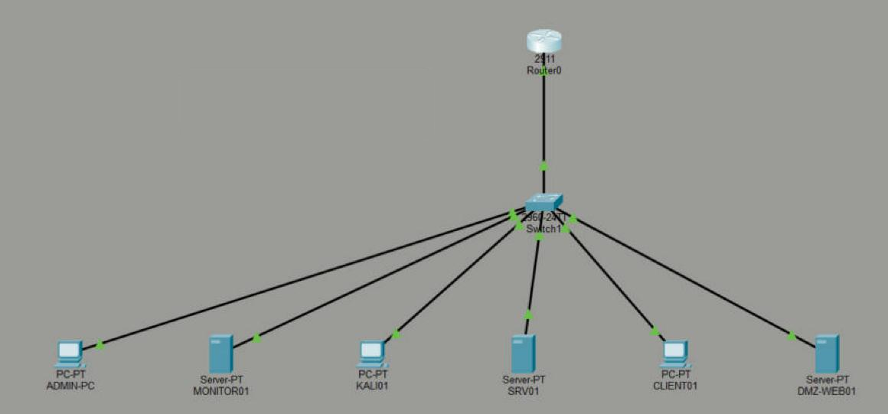

# Cisco: CORE-SW1 and the edge router (assignment 11, VLAN isolation)

The VirtualBox lab uses pfSense as the firewall and VirtualBox internal networks as the zones. The Cisco
side of the design (an access/core switch with VLANs, an 802.1Q trunk and port security, plus a
router-on-a-stick that enforces the zone policy with ACLs) is built and tested in **Cisco Packet Tracer 9.0**.

| File | What it is |
|---|---|
| [`core-sw1.cfg`](core-sw1.cfg) | CORE-SW1 (Catalyst 2960): VLANs 10/20/30/40/50, parking VLAN 999, trunk, port security, DHCP snooping, BPDU guard, SSH-only management, SNMPv3 |
| [`fw01-edge.cfg`](fw01-edge.cfg) | FW01 (ISR 2911): sub-interface gateways, per-zone inbound ACLs (same policy as pfSense), DHCP for Users, NAT, SSH, SNMPv3 |
| [`packet-tracer/make_pt_configs.py`](packet-tracer/make_pt_configs.py) | turns the two configs into Packet Tracer pastes (`packet-tracer/configs/`) |
| [`packet-tracer/pel-lab.pkt`](packet-tracer/pel-lab.pkt) | the working Packet Tracer topology |

Secrets in the `.cfg` files are placeholders (`<ENABLE_SECRET>`, `<ADMIN_SECRET>`, `<SNMP_*>`). The build fills
them from the git-ignored `.lab-local/pt-secrets.env`, with values used only in Packet Tracer.

## Topology in Packet Tracer

| Device (display name) | Hostname | Port | VLAN / address |
|---|---|---|---|
| Router0 | FW01 | G0/0 → CORE-SW1 Gi0/1 (trunk) | .1 gateway on every zone, sub-interfaces G0/0.10–.50 |
| Switch1 | CORE-SW1 | Gi0/1 trunk; Fa0/1–6 access | SVI VLAN 10 192.168.10.2 |
| ADMIN-PC | – | Fa0/1 | VLAN 10, 192.168.10.10 |
| MONITOR01 | – | Fa0/2 | VLAN 20, 192.168.20.10 |
| KALI01 | – | Fa0/3 | VLAN 40, 192.168.40.10 |
| SRV01 | – | Fa0/4 | VLAN 20, 192.168.20.20 (DNS: srv01, intranet, www, monitor01 in corp.lab; HTTP) |
| CLIENT01 | – | Fa0/5 | VLAN 30, DHCP from FW01 (got 192.168.30.100) |
| DMZ-WEB01 | – | Fa0/6 | VLAN 50, 192.168.50.10 (HTTP) |

Unused ports Fa0/7–24 and Gi0/2 are shut down and parked in VLAN 999; the trunk's native VLAN is 999 and it
carries only VLANs 10–50.

## Changes needed for Packet Tracer

Packet Tracer's IOS is a subset, so `make_pt_configs.py` adjusts the configs (each change is explained in the script):

* `snmp-server` lines and the SNMP-MANAGER ACL are removed: Packet Tracer has no SNMPv3 agent. SNMPv3 is
  built and tested on the VirtualBox lab instead (fw01, srv01, dmz-web01 polled by LibreNMS).
* `logging trap` and the `log` keyword on ACL entries are removed (not in Packet Tracer's parser).
* `crypto key generate rsa general-keys modulus 2048`, so the key is generated without a prompt.
* G0/1 (WAN) stays down: there is no ISP device in the Packet Tracer file.

## Verification (all run in Packet Tracer, 2026-11-09)

| Check | Command / test | Result | Evidence |
|---|---|---|---|
| VLANs and access ports | `show vlan brief` | 10 Fa0/1, 20 Fa0/2+Fa0/4, 30 Fa0/5, 40 Fa0/3, 50 Fa0/6, 999 the rest | [pt-01](../screenshots/packet-tracer/pt-01-core-sw1-vlan-brief.jpg) |
| Trunk | `show interfaces trunk` | Gi0/1 on, 802.1q, native 999, allowed and forwarding 10,20,30,40,50 | [pt-02](../screenshots/packet-tracer/pt-02-core-sw1-trunk.jpg) |
| Port security, DHCP snooping | `show port-security`, `show ip dhcp snooping` | Fa0/1 and Fa0/5 secure (max 2, restrict, 0 violations); snooping on VLAN 30, Gi0/1 trusted, Fa0/5 rate-limited | [pt-03](../screenshots/packet-tracer/pt-03-core-sw1-port-security-dhcp-snooping.jpg) |
| Router interfaces, DHCP | `show ip interface brief`, `show ip dhcp binding` | G0/0.10–.50 up/up; CLIENT01 lease 192.168.30.100 | [pt-08](../screenshots/packet-tracer/pt-08-fw01-interfaces-dhcp-binding.jpg) |
| Management reaches every zone | ADMIN-PC ping srv01, dmz-web01, client01, kali01 | all reply (first packet to kali01 lost to ARP) | [pt-04](../screenshots/packet-tracer/pt-04-admin-pc-reaches-all-zones.jpg) |
| Users isolated from Management | CLIENT01 ping 192.168.10.10 | **Destination host unreachable** from 192.168.30.1 (ACL deny) | [pt-05](../screenshots/packet-tracer/pt-05-client01-dhcp-isolation-dns.jpg) |
| Users get their services | CLIENT01 `nslookup srv01.corp.lab`, browser `http://intranet.corp.lab` | name resolved to 192.168.20.20, page loads | [pt-05](../screenshots/packet-tracer/pt-05-client01-dhcp-isolation-dns.jpg), [pt-06](../screenshots/packet-tracer/pt-06-client01-http-intranet.jpg) |
| DMZ never reaches Management | DMZ-WEB01 ping 192.168.10.10 | **Destination host unreachable** (DMZ-IN deny) | [pt-07](../screenshots/packet-tracer/pt-07-dmz-to-mgmt-blocked.jpg) |
| ACL is what blocks it | `show access-lists USERS-IN` | DNS 3, www 5 matches; `deny ip 192.168.30.0/24 192.168.0.0/16` 2 matches | [pt-09](../screenshots/packet-tracer/pt-09-fw01-users-acl-hits.jpg) |

The DMZ server cannot ping its own gateway either. That is intended: DMZ-IN allows only replies, SNMP and
the Wazuh agent ports to monitor01, and web traffic out.

## Problem found while building

The router–switch link stayed down after the configs were pasted: FW01 G0/0 was `up/down`, and CORE-SW1 Gi0/1
was `down/down (disabled)` with no CDP neighbour. `shutdown`/`no shutdown`, `no switchport nonegotiate` and
`speed/duplex auto` changed nothing. The cable was a **copper cross-over**, which Packet Tracer 9 does not
bring up between a router and a switch. Replacing it with a straight-through cable brought the trunk up at
once, and every sub-interface went up/up. Lesson: check layer 1 (cable type, `show interfaces` status
reason) before debugging trunk settings.
