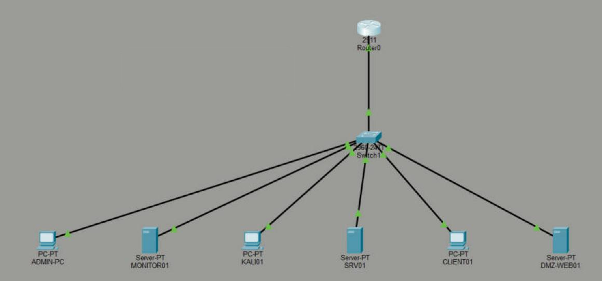

# Topology

Addressing plan: [`ip-addressing.csv`](ip-addressing.csv).

## VirtualBox lab (what runs the services and the attacks)

```
                    Internet (VirtualBox NAT, 10.0.2.0/24)
                                  |
                         fw01  pfSense CE 2.7.2
                    routing, default-deny rules, NAT, DHCP (Users), syslog out
     +---------------+------------+------------+---------------+
  pel-mgmt       pel-servers   pel-users   pel-security      pel-dmz
  192.168.10/24  .20/24        .30/24      .40/24            .50/24
  (switch SVI    monitor01 .10 client01    kali01 .10        dmz-web01 .10
   in PT)        srv01 .20     DHCP .100+
```

Each zone is a VirtualBox internal network: a separate layer-2 segment whose only exit is fw01, which is
what an access VLAN behind a firewall gives you. monitor01 has a second, address-less NIC on the DMZ
network so Suricata also sees DMZ traffic.

## Cisco design (Packet Tracer)



One 802.1Q trunk from CORE-SW1 Gi0/1 to FW01 G0/0, with one sub-interface per zone (router-on-a-stick).
Details and test results: [`../cisco/README.md`](../cisco/README.md).
